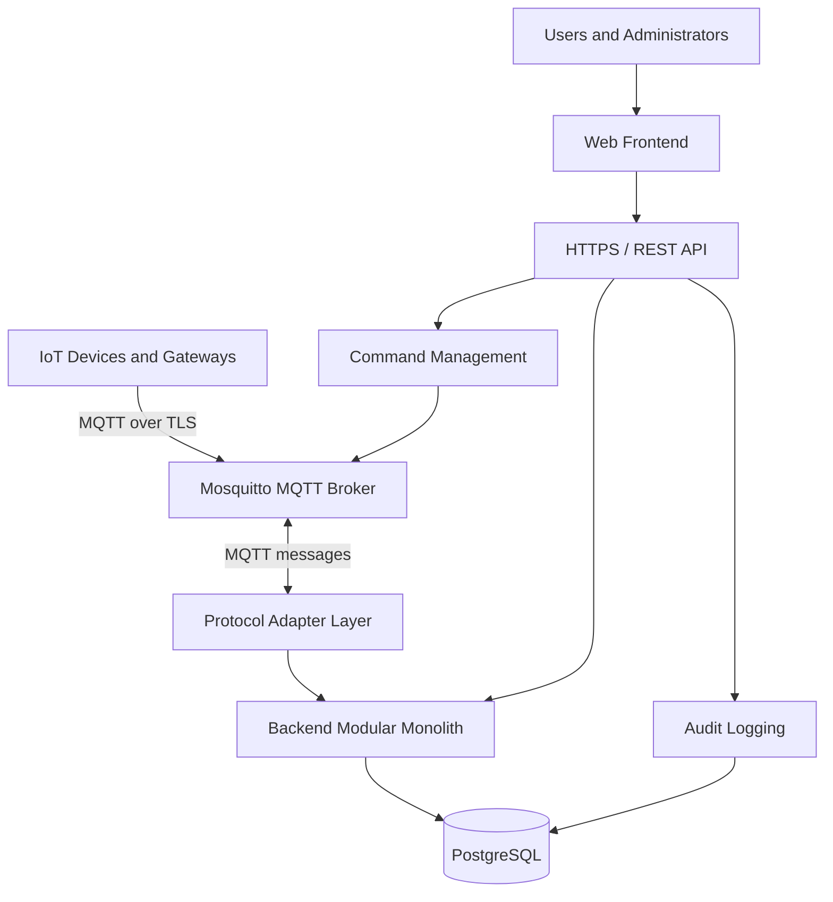

# Smart IoT Platform
## System Architecture Document

**Document:** SYSTEM_ARCHITECTURE.md  
**Project:** Smart IoT Platform  
**Version:** 1.0  
**Status:** Draft - Phase 1 Baseline  
**Last Updated:** 2026-11-02

---

## 1. Purpose

This document describes the target architecture for Smart IoT Platform, including its application structure, infrastructure components, communication flows, data boundaries, security principles, and deployment model.

The architecture targets a self-hosted ARM64 server with constrained resources. It prioritizes maintainability, security, operational simplicity, and future extensibility.

Approved decisions are separated from implementation details that remain open.

## 2. Architecture Principles

1. **Modular Monolith:** One backend deployment with clearly separated internal modules.
2. **Protocol Independence:** Isolate device protocols behind adapter interfaces.
3. **MQTT First:** MQTT is the primary device messaging protocol.
4. **API Driven:** Application capabilities are exposed through HTTP/REST APIs.
5. **Data Ownership:** PostgreSQL is the primary persistent relational database.
6. **Security by Design:** Apply authentication, authorization, encryption, and least privilege.
7. **Resource Awareness:** Minimize infrastructure components and resource consumption.
8. **ARM64 Compatibility:** Runtime images and dependencies must support ARM64.
9. **Operational Simplicity:** Use Docker Compose for initial self-hosted deployment.
10. **Incremental Evolution:** Avoid premature distributed-system complexity.

## 3. Approved Architecture Decisions

| Area | Decision |
|---|---|
| Backend architecture | Modular Monolith |
| Device integration | Multi-Protocol Adapter Architecture |
| Primary device protocol | MQTT |
| Application API | HTTP/REST |
| Future industrial protocol | Modbus TCP/RTU |
| Primary database | PostgreSQL |
| MQTT broker | Eclipse Mosquitto |
| Deployment | Self-hosted |
| Container orchestration | Docker Compose |
| Initial product priorities | Device Management and Monitoring |
| Primary data storage | External SSD mounted at `/data` |
| Target server architecture | ARM64 |

The programming language, backend framework, frontend framework, and reverse proxy remain open decisions.

## 4. High-Level System Architecture

The platform consists of six logical layers:

1. Device Layer
2. Communication Layer
3. Backend Application Layer
4. Data Layer
5. User Interface Layer
6. Infrastructure and Operations Layer

### 4.1 Logical Architecture

## 5. Backend Architecture

### 5.1 Modular Monolith

The backend is initially deployed as one application with clearly separated internal modules.

Each module should:
- Own its business logic and validation rules.
- Expose well-defined internal interfaces.
- Avoid directly modifying another module internal data.
- Be independently testable where practical.
- Avoid circular dependencies.

### 5.2 Proposed Modules

| Module | Responsibility |
|---|---|
| Identity and Access | Authentication, roles, permissions, and sessions |
| Device Registry | Device registration, metadata, configuration, and lifecycle |
| Device Communication | MQTT handling and protocol adapter interfaces |
| Telemetry | Telemetry validation, processing, and persistence |
| Command Management | Device commands, publishing, and result tracking |
| Audit Logging | Security-sensitive and administrative event records |
| API Layer | REST endpoints, request validation, and responses |
| Operations and Health | Health checks and operational diagnostics |

These are logical modules, not separate Phase 1 deployments.

### 5.3 Dependency Direction

The API layer calls application services rather than directly implementing business rules.

Protocol adapters translate protocol-specific messages into application-level events and commands. Core business logic must not depend on MQTT-specific implementation details.

Database access should use controlled repositories or data-access components.

## 6. Multi-Protocol Adapter Architecture

### 6.1 Adapter Responsibilities

Each protocol adapter should:
- Receive device messages.
- Validate and translate protocol payloads.
- Map external device identity to registered devices.
- Publish commands where supported.
- Report communication status and errors.
- Translate protocol-specific errors into application-level results.

### 6.2 MQTT Adapter

MQTT is the primary adapter in Phase 1.

The MQTT adapter communicates with Eclipse Mosquitto and translates incoming messages into application events. Outgoing commands are translated into MQTT publications.

The exact topic convention, payload schema, QoS selection, retained-message policy, and session behavior remain to be specified.

### 6.3 Modbus Adapter

Modbus TCP/RTU is planned for a later phase.

Register maps, polling intervals, data types, scaling, and device-specific configuration must be defined before implementation. Modbus integration is not a Phase 1 dependency.

## 7. Communication Flows

### 7.1 Telemetry Ingestion

1. A registered device sends telemetry to its authorized MQTT topic.
2. Mosquitto receives the publication.
3. The MQTT adapter receives the message.
4. The adapter validates device identity and translates the payload.
5. The telemetry module validates application-level data.
6. Valid telemetry is persisted in PostgreSQL.
7. The REST API exposes device state and telemetry.
8. The frontend retrieves and displays the information.

Invalid messages must not silently corrupt device records. Error handling and quarantine behavior will be defined during implementation.

### 7.2 Device Command Flow

1. An authenticated user requests a command through the frontend.
2. The REST API authenticates the user and checks authorization.
3. The command module validates the target device and command.
4. The application records the command and its initial status.
5. The MQTT adapter publishes the command.
6. The device may publish a response or acknowledgement.
7. The application updates command status when a valid response is received.

A successful MQTT publication does not prove that the device executed the command. Delivery and execution status must be represented separately.

### 7.3 User API Flow

1. A user accesses the web frontend.
2. The frontend communicates through HTTPS.
3. The API authenticates the request.
4. Authorization is checked before protected operations.
5. The relevant application module processes the request.
6. Data is read from or written to PostgreSQL.
7. The API returns a structured response.

## 8. Data Architecture

### 8.1 Primary Database

PostgreSQL is the primary relational database.

It will initially store:
- User accounts and role assignments.
- Device registry and metadata.
- Device credential references and provisioning information.
- Device configuration.
- Telemetry records and latest device state.
- Command records and execution status.
- Audit events.
- Application configuration suitable for database storage.

### 8.2 Data Ownership

Each logical module owns the business rules for its data.

Database tables should use appropriate:
- Primary keys and foreign keys.
- Unique constraints.
- Indexes.
- Timestamps.
- Data validation constraints.
- Retention and archival policies where required.

Detailed schemas and indexes belong in `DATABASE_DESIGN.md`.

### 8.3 Telemetry Growth

Telemetry volume depends on device count, message frequency, and payload size. These requirements are not yet known.

The initial design should avoid premature infrastructure complexity. Retention, partitioning, archival, and specialized time-series storage should be evaluated using measured workload data.

## 9. Deployment Architecture

### 9.1 Initial Deployment Model

The initial deployment is a single self-hosted ARM64 server using Docker Compose.

The intended logical services are:

| Service | Responsibility |
|---|---|
| Backend | Modular Monolith application |
| Mosquitto | MQTT message broker |
| PostgreSQL | Persistent relational database |
| Frontend | Web application |
| HTTPS Reverse Proxy | External HTTPS entry point |

The reverse proxy implementation has not yet been selected.

Redis and other additional infrastructure services are excluded from the initial baseline unless a demonstrated requirement justifies them.

### 9.2 Container and Network Boundaries

- Services should communicate over private Docker networks.
- PostgreSQL must not be exposed directly to the public network.
- Mosquitto listener exposure must be restricted to required clients.
- MQTT authentication and topic authorization must be enabled.
- The public application entry point should use HTTPS.
- Administrative access should be restricted.
- Container privileges and mounted filesystem access should be minimized.

### 9.3 Persistent Storage

Persistent application data must be stored outside disposable container layers.

The external SSD is mounted at `/data`. Planned storage locations include:

| Path | Purpose |
|---|---|
| `/data/projects` | Source repositories and project files |
| `/data/database` | Database persistent data |
| `/data/backups` | Backup files |
| `/data/uploads` | Application uploads, if required |

Service-specific directories and ownership must be established during deployment design.

The external SSD is primary storage, not an independent backup destination.

### 9.4 Resource Constraints

The current server has approximately 4 CPU cores and 3.7 GiB of RAM.

The deployment must be tested under realistic workloads. Resource limits should be introduced based on observed memory and CPU usage.

ARM64-compatible container images are required.

## 10. Security Architecture

### 10.1 Network Security

- Use HTTPS for application access.
- Use MQTT over TLS for remote device connections where supported.
- Restrict inbound ports through firewall rules.
- Keep database traffic on private networks.
- Avoid exposing internal administrative interfaces unnecessarily.

### 10.2 Identity and Authorization

- Users must authenticate before accessing protected functions.
- Apply role-based access control.
- Each device must have an individual identity and credentials.
- Device credentials must not be shared across unrelated devices.
- MQTT topic permissions must restrict devices to authorized topics.
- Administrative and security-sensitive operations must be auditable.

### 10.3 Secrets Management

- Never commit passwords, private keys, tokens, or production credentials to Git.
- Keep secrets outside source-controlled files.
- Restrict filesystem permissions for secret material.
- Use separate credentials for development and production.
- Define a credential rotation procedure before production deployment.

### 10.4 Data Protection

- Apply least-privilege database accounts.
- Do not expose PostgreSQL publicly.
- Protect backups against unauthorized access.
- Define retention and deletion policies for sensitive data.
- Avoid logging passwords, tokens, or private credentials.

## 11. Reliability and Operations

### 11.1 Health Checks

The application should expose health information sufficient to identify:
- Application process availability.
- Database connectivity.
- MQTT broker connectivity.
- Critical dependency failures.

Health checks must not reveal credentials or sensitive configuration.

### 11.2 Logging

Logs should include useful timestamps, severity levels, and correlation information where appropriate.

Logs should support diagnosis of:
- Authentication and authorization failures.
- Device connection problems.
- MQTT message processing errors.
- API errors.
- Database failures.
- Command delivery and execution status.

Sensitive values must be excluded or masked.

### 11.3 Backup and Recovery

The deployment must provide repeatable backup and restore procedures for PostgreSQL and required application data.

Backups stored only on the same external SSD do not protect against failure or loss of that SSD. A separate backup destination is required for meaningful disaster recovery.

Restore procedures must be tested before production use.

### 11.4 Availability Scope

The initial deployment is single-node. High availability, automated failover, and multi-node clustering are outside the Phase 1 baseline.

## 12. Observability

The initial operational baseline should include:
- Container and application logs.
- Application health endpoints.
- Database availability checks.
- MQTT broker availability checks.
- Disk-space monitoring.
- CPU and memory monitoring.
- Backup success and failure reporting.

A dedicated metrics and tracing stack may be considered later if operational needs justify its resource cost.

## 13. Architecture Evolution

The architecture may evolve through the following stages:

1. **Phase 1:** Modular Monolith, MQTT, REST API, PostgreSQL, and basic device management and monitoring.
2. **Phase 2:** Add Modbus TCP/RTU through the adapter architecture.
3. **Phase 3:** Evaluate analytics, automation, notifications, OTA, multi-site support, and scaling improvements.
4. **Future:** Consider extracting services or adding high-availability infrastructure only when justified by measured needs.

Changes must preserve clear module boundaries and documented API contracts.

## 14. Open Architecture Decisions

The following items require separate decisions before the relevant implementation:
- Backend programming language and framework.
- Frontend framework.
- HTTPS reverse proxy implementation.
- MQTT topic naming convention and payload schema.
- MQTT QoS and session policy by message type.
- Device provisioning and credential rotation workflow.
- User authentication mechanism and session strategy.
- Telemetry retention period and expected data volume.
- Backup destination and recovery objectives.
- Expected device count and telemetry frequency.
- Modbus gateway and register-mapping strategy.
- Production TLS certificate and renewal process.

Open decisions must not be treated as approved implementation choices.

## 15. Related Documents

- `PROJECT_REQUIREMENTS.md`
- `DEVELOPMENT_ROADMAP.md`
- `DATABASE_DESIGN.md` (planned)
- `API_SPECIFICATION.md` (planned)
- `UI_UX_GUIDELINES.md` (planned)
- `TESTING_STRATEGY.md` (planned)
- `CHANGELOG.md` (planned)

---

**End of Document**
